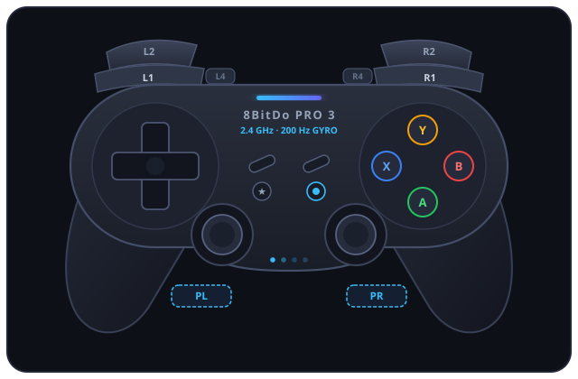

<p align="center">
  
</p>

<h1 align="center">Pro 3 · 2.4 GHz Gyro Bridge</h1>

<p align="center">
  Unofficial 200 Hz gyroscope, rumble and DSU bridge for the <b>8BitDo Pro 3</b> over its stock <b>2.4 GHz dongle</b> on Windows.<br/>
  Native Steam Input gyro (virtual DualShock 4) + Cemuhook/DSU for emulators · RAM-only, no firmware flashing.
</p>

<p align="center">
  <a href="https://github.com/NicolasBeatum/pro3-24g-gyro-bridge/releases/latest"></a>
  
  
  <a href="LICENSE"></a>
  <a href="https://github.com/NicolasBeatum/pro3-24g-gyro-bridge/actions/workflows/build.yml"></a>
</p>

<p align="center">
  <b>English</b> · <a href="README_ES.md">Español</a>
</p>

<p align="center">
  
</p>

> [!NOTE]
> **Unofficial community project.** Not affiliated with, endorsed by, or sponsored by 8BitDo, Sony, or Microsoft. See [Legal & Trademark Disclaimer](#legal--trademark-disclaimer) and [AI-Assisted Development](#ai-assisted-development-disclaimer).

---

## Download

1. Grab **`pro3-bridge.exe`** from the **[latest release](https://github.com/NicolasBeatum/pro3-24g-gyro-bridge/releases/latest)** — a single portable `.exe`, no installer, no admin rights.
2. *(For Steam / PC games)* install the **[ViGEmBus](https://github.com/nefarius/ViGEmBus/releases)** driver so the app can create a virtual DualShock 4. It is **optional** if you only use DSU motion in emulators (Dolphin, Cemu, Ryujinx, …).
3. Plug in the Pro 3's 2.4 GHz dongle, open `pro3-bridge.exe` and click **Start**.

> [!TIP]
> **Windows SmartScreen** may warn about an unrecognized app, because the `.exe` is open source but not code-signed. Click **More info → Run anyway**, or [build it from source](#build-from-source) yourself. Each release lists the SHA-256 of the binary so you can verify it.

## Features

- **Native Steam Input gyro** — creates a virtual **DualShock 4** through ViGEmBus (`DS4_REPORT_EX`) with real 3-axis gyroscope + accelerometer at **200 Hz**. Steam's own gyro settings, calibration, Flick Stick, gyro-to-mouse and per-game profiles all work.
- **Emulators (DSU / Cemuhook, `127.0.0.1:26760`)** — built-in 200 Hz motion + rumble server for **Cemu, Dolphin, Ryujinx, Yuzu-based forks, RPCS3, Citra/Azahar**, running alongside the virtual pad.
- **Dual rumble** — left/right motor vibration from Steam/PC games and DSU clients is forwarded back to the controller.
- **Full analog triggers** — `L2 / R2` keep their `0..255` range.
- **Back paddles `PL` / `PR`** — live indicator plus remapping to touchpad click, gyro recalibrate / pause, gamepad buttons or keyboard keys.
- **Optional direct PC gyro** — built-in gyro → mouse (`SendInput`) and gyro → right stick for non-Steam games or Xbox 360 mode.
- **Native Rust GUI** — live controller visualizer, artificial-horizon gauge, system-tray support, bilingual **EN / ES** interface and a portable config file next to the `.exe`.

## How It Works

The stock dongle has a RAM-only telemetry mode (`2DC8:600A`) that streams buttons, sticks, analog triggers, accelerometer, gyroscope and battery at ~200 Hz and accepts rumble commands. The bridge simply switches it on and translates the data.

- **Starts stopped.** Nothing touches the dongle until you click **Start** (you can enable auto-start in *Advanced*).
- **Start** → the dongle switches to 200 Hz telemetry, the virtual DualShock 4 (or Xbox 360) pad appears, the DSU server starts, and rumble, analog triggers and `PL` / `PR` paddles are live.
- **Stop** or **Exit** → the bridge sends a clean watchdog reset (`[0x81, 0x00, 0x1B]`) and the dongle returns to stock **XInput** (`2DC8:310B`) in **~6 s** — no unplugging. The controller powers off briefly while the dongle reboots; **just turn it back on**.
- **Never writes flash or firmware** on the dongle or controller, and never sends firmware-update / bootloader commands. Unplugging the dongle always restores stock behaviour too.
- **Local only.** The DSU server binds to `127.0.0.1` (loopback). No telemetry, no internet access, no admin elevation. The only network action is opening the repository link in your browser if you click it in *About*.

Byte-level details (USB modes, commands, 64-byte report layout, button bitmask, sensor frames, rumble): **[docs/PROTOCOL.md](docs/PROTOCOL.md)**.

## Quick Setup

### Steam (native gyro)
1. Open `pro3-bridge.exe` and click **Start** (default output: **DualShock 4 · Native gyro**).
2. In **Steam → Settings → Controller**, enable **Steam Input for PlayStation controllers**.
3. Steam detects a **DualShock 4** with gyro and rumble. Configure gyro per game in Steam's controller layout.

### Emulators (DSU / Cemuhook)
With the bridge running (DSU server on `127.0.0.1:26760`):
- **Dolphin:** *Controllers → Alternate Input Sources → Enable → Add* `127.0.0.1:26760`.
- **Cemu:** *Options → Input Settings → API: DSUController* (or use it as the motion source).
- **Ryujinx / Yuzu-based forks:** *Controls → Motion → Use CemuHook UDP →* `127.0.0.1:26760`.

## Known Limitations

- **Steam shows the virtual pad as a "DualShock 4".** Native gyro in Steam Input requires a controller type that ViGEmBus can emulate with motion, and that is the DS4. You can give it a custom name locally in Steam's controller settings.
- **`L4` / `R4` have no raw bits of their own over 2.4 GHz** when unmapped. Map them to a standard button on the controller (on-board profile) or with 8BitDo Ultimate Software and they will work everywhere. `PL` / `PR` *do* arrive as independent bits.
- **Windows only** (Windows 10 / 11, 64-bit).
- Tested with the Pro 3 2.4 GHz dongle on firmware **v1.02**. Future firmware updates could change the behaviour.

## Build from Source

Requires the [Rust toolchain](https://rustup.rs/) (stable, MSVC).

```powershell
git clone https://github.com/NicolasBeatum/pro3-24g-gyro-bridge.git
cd pro3-24g-gyro-bridge/pro3-bridge
cargo build --release
```

Output: `pro3-bridge/target/release/pro3-bridge.exe` (single standalone `.exe`, no extra DLLs). CI builds the same binary on every push ([workflow](.github/workflows/build.yml)).

## Python Reference Implementation

A standalone Python version lives in [`python/`](python/) (console messages are in Spanish):

```powershell
pip install hidapi vgamepad
python python/pro3_bridge.py
```

| Launcher | Mode |
|---|---|
| `Iniciar_Steam_DS4_GyroNativo.bat` | Virtual DualShock 4 with native Steam gyro + DSU |
| `Iniciar_Emuladores_DSU.bat` | DSU server for emulators + virtual pad |
| `Iniciar_Steam_GyroMouse.bat` | Gyro → mouse (hold L2) + DSU |
| `Iniciar_Steam_GyroStick.bat` | Gyro → right stick (hold L2) + DSU |
| `Volver_a_XInput.bat` | Returns the dongle to stock XInput (`2DC8:310B`) in ~6 s |

## Project Structure

```
.
├── pro3-bridge/          # Native Rust GUI app (pro3-bridge.exe)
│   └── src/              # protocol · dsu · vigem · bridge · ui · config · input_sim
├── python/               # Python reference implementation + .bat launchers
├── docs/PROTOCOL.md      # 2.4 GHz dongle HID protocol reference
├── assets/               # Brand-neutral controller outline + app icon (SVG / ICO)
└── .github/workflows/    # Windows release build (CI)
```

## AI-Assisted Development Disclaimer

This project was developed **with the help of AI coding assistants: Gemini Neon and Claude Opus 5.5** (code, documentation and artwork). Every change was directed, reviewed and tested by the author on real hardware, but AI-assisted code can still contain mistakes. Please read the source, report issues, and use the software at your own risk.

## Legal & Trademark Disclaimer

- This is an **unofficial, independent, open-source interoperability project**. It is **not affiliated with, endorsed by, or sponsored by 8BitDo, Sony, Microsoft, or Valve**.
- *8BitDo*, *Pro 3*, *DualShock*, *PlayStation*, *Xbox*, *XInput*, *Steam* and all other product names and trademarks belong to their respective owners and are used here only to describe compatibility.
- **No firmware is flashed or modified.** The bridge only uses the dongle's existing RAM-only USB commands; everything is reversible by clicking Stop, exiting, or unplugging the dongle.
- No vendor firmware, source code or binaries are included or redistributed. The controller artwork and icon are original, brand-neutral drawings with no logos or text.
- The software is provided **"AS IS", without warranty of any kind**, under the [MIT License](LICENSE).

## License

[MIT](LICENSE) © 2026 NicolasBeatum
