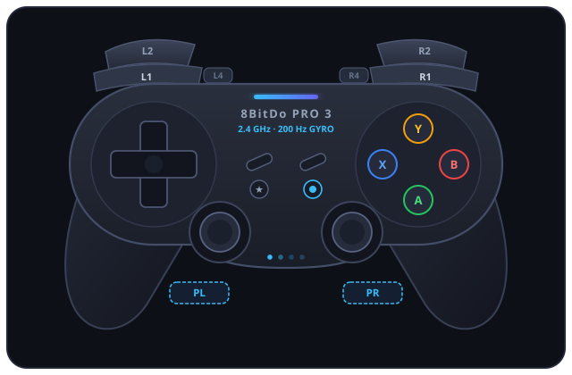

<p align="center">
  
</p>

<h1 align="center">Pro 3 · 2.4 GHz Gyro Bridge</h1>

<p align="center">
  Puente no oficial de giroscopio a 200 Hz, vibración y DSU para el <b>8BitDo Pro 3</b> mediante su <b>dongle 2.4 GHz</b> de fábrica en Windows.<br/>
  Giroscopio nativo en Steam Input (DualShock 4 virtual) + Cemuhook/DSU para emuladores · Solo en RAM, sin flashear firmware.
</p>

<p align="center">
  <a href="https://github.com/NicolasBeatum/pro3-24g-gyro-bridge/releases/latest"></a>
  
  
  <a href="LICENSE"></a>
  <a href="https://github.com/NicolasBeatum/pro3-24g-gyro-bridge/actions/workflows/build.yml"></a>
</p>

<p align="center">
  <a href="README.md">English</a> · <b>Español</b>
</p>

<p align="center">
  
</p>

> [!NOTE]
> **Proyecto comunitario no oficial.** No está afiliado, respaldado ni patrocinado por 8BitDo, Sony ni Microsoft. Consulta el [Aviso legal y de marcas](#aviso-legal-y-de-marcas) y el [Aviso de desarrollo asistido por IA](#aviso-de-desarrollo-asistido-por-ia).

---

## Descarga

1. Descarga **`pro3-bridge.exe`** desde la **[última versión](https://github.com/NicolasBeatum/pro3-24g-gyro-bridge/releases/latest)**: un único `.exe` portable, sin instalador y sin permisos de administrador.
2. *(Para Steam / juegos de PC)* instala el controlador **[ViGEmBus](https://github.com/nefarius/ViGEmBus/releases)** para que la app pueda crear un DualShock 4 virtual. Es **opcional** si solo usas el movimiento por DSU en emuladores (Dolphin, Cemu, Ryujinx, …).
3. Conecta el dongle 2.4 GHz del Pro 3, abre `pro3-bridge.exe` y pulsa **Iniciar**.

> [!TIP]
> **Windows SmartScreen** puede mostrar un aviso de aplicación no reconocida, porque el `.exe` es de código abierto pero no está firmado digitalmente. Pulsa **Más información → Ejecutar de todas formas**, o [compílalo desde el código fuente](#compilar-desde-el-código-fuente). Cada versión incluye el SHA-256 del binario para que puedas verificarlo.

## Características

- **Giroscopio nativo en Steam Input**: crea un **DualShock 4** virtual mediante ViGEmBus (`DS4_REPORT_EX`) con giroscopio y acelerómetro reales de 3 ejes a **200 Hz**. Funcionan los ajustes de giroscopio de Steam, la calibración, Flick Stick, giroscopio como mouse y los perfiles por juego.
- **Emuladores (DSU / Cemuhook, `127.0.0.1:26760`)**: servidor integrado de movimiento y vibración a 200 Hz para **Cemu, Dolphin, Ryujinx, forks basados en Yuzu, RPCS3 y Citra/Azahar**, en paralelo con el mando virtual.
- **Vibración doble**: la vibración de los motores izquierdo y derecho de Steam, juegos de PC y clientes DSU se reenvía al mando.
- **Gatillos analógicos completos**: `L2 / R2` mantienen su rango `0..255`.
- **Botones traseros `PL` / `PR`**: indicador en vivo y reasignación a clic del touchpad, recalibrar / pausar el giroscopio, botones del mando o teclas del teclado.
- **Giroscopio directo en PC (opcional)**: giroscopio → mouse (`SendInput`) y giroscopio → stick derecho para juegos fuera de Steam o en modo Xbox 360.
- **Interfaz nativa en Rust**: visualizador del mando en vivo, horizonte artificial, bandeja del sistema, interfaz bilingüe **ES / EN** y archivo de configuración portable junto al `.exe`.

## Cómo funciona

El dongle de fábrica tiene un modo de telemetría solo en RAM (`2DC8:600A`) que envía botones, sticks, gatillos analógicos, acelerómetro, giroscopio y batería a ~200 Hz, y acepta comandos de vibración. El puente simplemente lo activa y traduce los datos.

- **Arranca detenido.** No toca el dongle hasta que pulses **Iniciar** (puedes activar el inicio automático en *Avanzado*).
- **Iniciar** → el dongle pasa a telemetría de 200 Hz, aparece el mando virtual DualShock 4 (o Xbox 360), arranca el servidor DSU y quedan activos la vibración, los gatillos analógicos y los botones `PL` / `PR`.
- **Detener** o **Salir** → el puente envía un reinicio limpio por watchdog (`[0x81, 0x00, 0x1B]`) y el dongle vuelve al modo **XInput** de fábrica (`2DC8:310B`) en **~6 s**, sin desenchufar nada. El mando se apaga un momento mientras el dongle se reinicia: **solo vuelve a encenderlo**.
- **Nunca escribe en la flash ni en el firmware** del dongle o del mando, y nunca envía comandos de actualización de firmware / bootloader. Desconectar el dongle también restaura siempre el comportamiento de fábrica.
- **Solo local.** El servidor DSU escucha únicamente en `127.0.0.1` (loopback). Sin telemetría, sin acceso a internet y sin elevación de administrador. La única acción de red es abrir el enlace del repositorio en tu navegador si lo pulsas en *Acerca de*.

Detalles a nivel de bytes (modos USB, comandos, estructura del reporte de 64 bytes, máscara de botones, ejes de sensores, vibración): **[docs/PROTOCOL.md](docs/PROTOCOL.md)** (en inglés).

## Configuración rápida

### Steam (giroscopio nativo)
1. Abre `pro3-bridge.exe` y pulsa **Iniciar** (salida por defecto: **DualShock 4 · Giroscopio nativo**).
2. En **Steam → Parámetros → Mando**, activa **Steam Input para mandos de PlayStation**.
3. Steam detectará un **DualShock 4** con giroscopio y vibración. Configura el giroscopio por juego en la configuración del mando de Steam.

### Emuladores (DSU / Cemuhook)
Con el puente en marcha (servidor DSU en `127.0.0.1:26760`):
- **Dolphin:** *Mandos → Fuentes de entrada alternativas → Activar → Añadir* `127.0.0.1:26760`.
- **Cemu:** *Opciones → Configuración de entrada → API: DSUController* (o úsalo como fuente de movimiento).
- **Ryujinx / forks basados en Yuzu:** *Controles → Movimiento → Usar CemuHook UDP →* `127.0.0.1:26760`.

## Limitaciones conocidas

- **Steam muestra el mando virtual como «DualShock 4».** El giroscopio nativo en Steam Input requiere un tipo de mando que ViGEmBus pueda emular con movimiento, y ese es el DS4. Puedes ponerle un nombre personalizado localmente en la configuración de mandos de Steam.
- **`L4` / `R4` sin asignar no tienen bits propios por 2.4 GHz.** Asígnales un botón estándar desde el propio mando (perfil integrado) o con 8BitDo Ultimate Software y funcionarán en cualquier juego. `PL` / `PR` *sí* llegan como bits independientes.
- **Solo Windows** (Windows 10 / 11, 64 bits).
- Probado con el dongle 2.4 GHz del Pro 3 con firmware **v1.02**. Futuras actualizaciones de firmware podrían cambiar el comportamiento.

## Compilar desde el código fuente

Requiere el [toolchain de Rust](https://rustup.rs/) (stable, MSVC).

```powershell
git clone https://github.com/NicolasBeatum/pro3-24g-gyro-bridge.git
cd pro3-24g-gyro-bridge/pro3-bridge
cargo build --release
```

Resultado: `pro3-bridge/target/release/pro3-bridge.exe` (un único `.exe` independiente, sin DLL adicionales). La CI compila el mismo binario en cada push ([workflow](.github/workflows/build.yml)).

## Implementación de referencia en Python

Hay una versión independiente en Python en [`python/`](python/):

```powershell
pip install hidapi vgamepad
python python/pro3_bridge.py
```

| Lanzador | Modo |
|---|---|
| `Iniciar_Steam_DS4_GyroNativo.bat` | DualShock 4 virtual con giroscopio nativo en Steam + DSU |
| `Iniciar_Emuladores_DSU.bat` | Servidor DSU para emuladores + mando virtual |
| `Iniciar_Steam_GyroMouse.bat` | Giroscopio → mouse (mantener L2) + DSU |
| `Iniciar_Steam_GyroStick.bat` | Giroscopio → stick derecho (mantener L2) + DSU |
| `Volver_a_XInput.bat` | Devuelve el dongle a XInput de fábrica (`2DC8:310B`) en ~6 s |

## Estructura del proyecto

```
.
├── pro3-bridge/          # App nativa en Rust (pro3-bridge.exe)
│   └── src/              # protocol · dsu · vigem · bridge · ui · config · input_sim
├── python/               # Implementación de referencia en Python + lanzadores .bat
├── docs/PROTOCOL.md      # Referencia del protocolo HID del dongle 2.4 GHz
├── assets/               # Silueta de mando sin marcas + icono de la app (SVG / ICO)
└── .github/workflows/    # Compilación de Windows (CI)
```

## Aviso de desarrollo asistido por IA

Este proyecto se desarrolló **con ayuda de asistentes de programación basados en IA** (código, documentación y gráficos). El autor dirigió, revisó y probó cada cambio con hardware real, pero el código asistido por IA puede contener errores. Revisa el código, reporta cualquier problema y usa el software bajo tu propia responsabilidad.

## Aviso legal y de marcas

- Este es un **proyecto de interoperabilidad no oficial, independiente y de código abierto**. **No está afiliado, respaldado ni patrocinado por 8BitDo, Sony, Microsoft ni Valve**.
- *8BitDo*, *Pro 3*, *DualShock*, *PlayStation*, *Xbox*, *XInput*, *Steam* y los demás nombres de productos y marcas pertenecen a sus respectivos dueños y se mencionan aquí solo para describir la compatibilidad.
- **No se flashea ni modifica ningún firmware.** El puente solo usa los comandos USB existentes del dongle, que actúan únicamente en RAM; todo se revierte al pulsar Detener, al salir o al desconectar el dongle.
- No se incluye ni redistribuye firmware, código fuente ni binarios de ningún fabricante. La silueta del mando y el icono son dibujos originales, sin logotipos ni texto.
- El software se ofrece **«TAL CUAL», sin garantía de ningún tipo**, bajo la [licencia MIT](LICENSE).

## Licencia

[MIT](LICENSE) © 2026 NicolasBeatum
